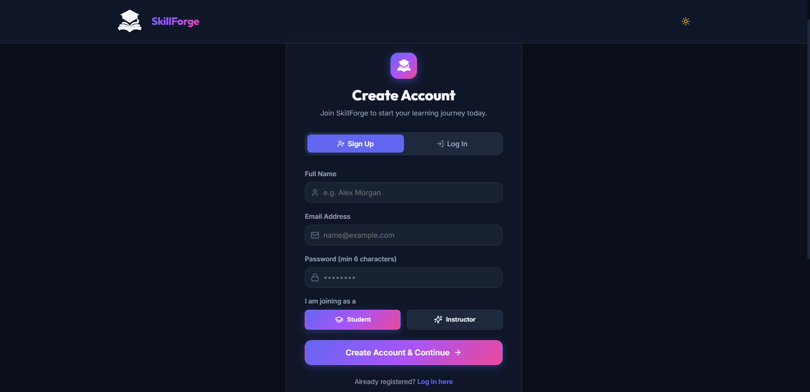
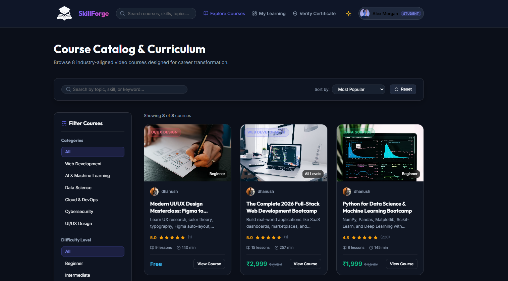
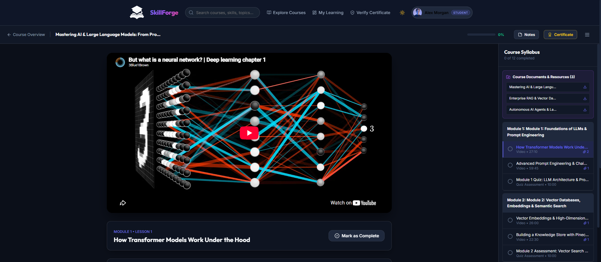
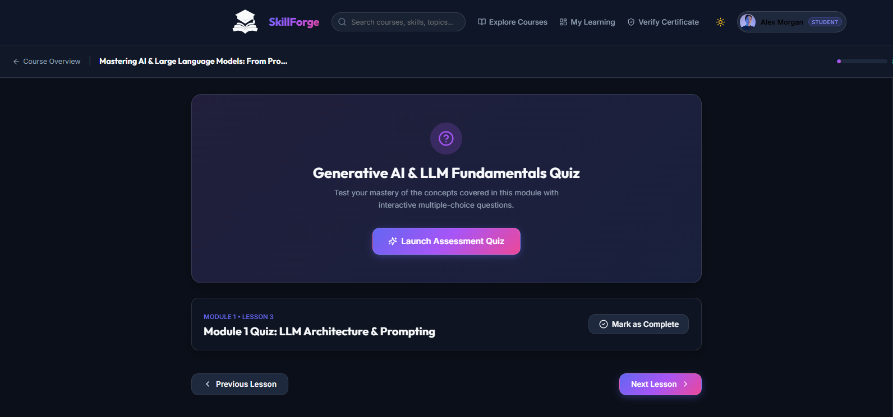
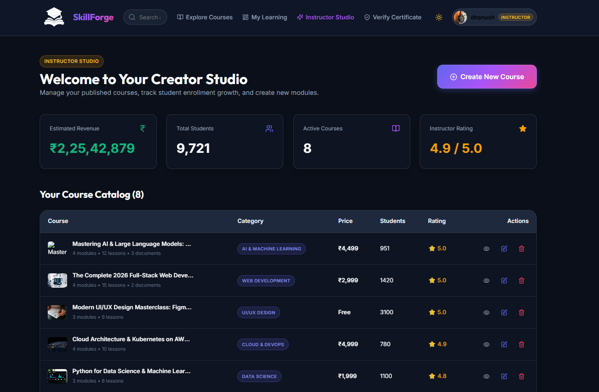

# SkillForge – Online Learning Platform

A full-stack **Learning Management System (LMS)** built with the **MERN stack** (MongoDB, Express.js, React, Node.js). Learners search courses, enrol (free or paid with PayPal), watch lectures, take graded quizzes, keep timestamped notes and earn certificates that anyone can verify. Instructors build and manage courses from a studio dashboard.

**Team 15 – Digita-minds** | Kalasalingam Academy of Research and Education

| | |
|---|---|
| **Live demo** | [Paste live link here] |
| **Repository** | https://github.com/charanreddyhari340-lgtm/learning-platform |
| **Documentation** | [`docs/SkillForge_Project_Documentation.pdf`](docs/SkillForge_Project_Documentation.pdf) |
| **Presentation** | [`docs/`](docs/) |

## Team

| Name | Registration No. | GitHub |
|---|---|---|
| K. Dhanush | [Reg. No.] | [GitHub link] |
| K. Navaneeth | 99230040029 | [GitHub link] |
| C. Hari Charan Reddy | 99230041153 | https://github.com/charanreddyhari340-lgtm |
| Allatipalli Vinod Babu | 99230040472 | [GitHub link] |
| A. Venkata Manikanta | 99230041151 | [GitHub link] |
| S. Akash | 99230040753 | [GitHub link] |

Trainer / Guide: **Ajusha**

## Features

**Learners**
- Course discovery with keyword search, category, level, price and rating filters, sorting and pagination
- Free enrolment and paid enrolment through PayPal (payment is verified on the server)
- Video classroom with playback speed control, lesson completion and progress tracking
- Graded quizzes with instant score and explanations
- Personal notes saved at the video timestamp
- Certificate issued automatically at 100% completion, with a public verification page (`/verify`)
- Course ratings and reviews
- Dashboard and profile

**Instructors / Admin**
- Studio dashboard: courses, students, estimated revenue, average rating, recent enrolments
- Course editor with modules, lessons, quizzes and resources
- File upload for documents, videos and images
- Create, edit, publish and delete courses

**Platform**
- JWT authentication, bcrypt password hashing and role-based access (student, instructor, admin)
- Auto-seeding of demo data, and an in-memory MongoDB fallback when no database URI is set
- Dark and light themes

## Tech Stack

| Layer | Technologies |
|---|---|
| Frontend | React 18, Vite 5, React Router 6, Lucide React, Canvas Confetti, custom CSS |
| Backend | Node.js, Express 4, Morgan, CORS, Dotenv, Multer |
| Database | MongoDB with Mongoose 8 (Atlas or in-memory) |
| Auth | JWT, bcryptjs |
| Payments | PayPal REST API, `@paypal/react-paypal-js` |
| Deployment | Vercel, MongoDB Atlas |

## Project Structure

```text
learning-platform/
├── client/                  # React single-page app
│   └── src/
│       ├── components/      # Navbar, Footer, VideoPlayer, QuizModal, PayPalCheckout ...
│       ├── context/         # Auth, Theme, Toast
│       ├── pages/           # Home, Courses, CourseDetails, CourseLearn, Dashboard ...
│       ├── services/        # API client
│       └── styles/
├── server/                  # Express API
│   ├── config/              # Database connection
│   ├── controllers/         # auth, course, enrollment, payment, review, instructor
│   ├── middleware/          # protect, authorize, error handling
│   ├── models/              # User, Course, Enrollment, Review
│   ├── routes/
│   ├── seeders/             # Demo data
│   └── server.js
├── docs/                    # Documentation and presentation
├── screenshots/             # Application screenshots
├── package.json             # Root scripts
└── vercel.json
```

## Getting Started

**Prerequisites:** Node.js 18 or higher. A MongoDB Atlas connection string is optional.

```bash
# 1. Clone
git clone https://github.com/charanreddyhari340-lgtm/learning-platform.git
cd learning-platform

# 2. Install server and client dependencies
npm run install-all

# 3. (Optional) create server/.env from server/.env.example

# 4. Run the API (port 5000) and the client (port 3000)
npm run dev
```

Open **http://localhost:3000**.

If `MONGODB_URI` is not set, the server starts an in-memory MongoDB and seeds demo data on first start.

**Production build**

```bash
npm run build
npm start        # serves the API and the built client on http://localhost:5000
```

> `npm run seed` clears the users, courses, enrolments and reviews collections before inserting demo data. Do not run it on a database with real data.

## Environment Variables

`server/.env`

| Variable | Purpose |
|---|---|
| `MONGODB_URI` | MongoDB connection string (empty = in-memory database) |
| `JWT_SECRET` | Secret used to sign tokens |
| `PORT` | API port, default 5000 |
| `CORS_ORIGIN` | Comma-separated allowed origins |
| `PAYPAL_CLIENT_ID`, `PAYPAL_CLIENT_SECRET` | PayPal API credentials |
| `PAYPAL_MODE`, `PAYPAL_CURRENCY` | `sandbox` or `live`; currency (default `INR`) |
| `ALLOW_SAMPLE_PAYMENTS` | `true` enables test enrolment for paid courses |

`client/.env`

| Variable | Purpose |
|---|---|
| `VITE_PAYPAL_CLIENT_ID` | PayPal client ID for the checkout buttons |
| `VITE_PAYPAL_CURRENCY` | Currency, default `INR` |

## Demo Accounts

| Role | Email | Password |
|---|---|---|
| Student | `student@skillforge.com` | `password123` |
| Instructor | `instructor@skillforge.com` | `password123` |
| Admin | `admin@skillforge.com` | `password123` |

Sample certificate ID for the `/verify` page: `CERT-SKILLFORGE-2026-UX99`

## Database Design

| Collection | Key fields |
|---|---|
| **User** | name, email (unique), password (hashed), role, avatar, headline, bio, skills, socialLinks |
| **Course** | title, slug, subtitle, description, category, level, price, instructor → User, modules[ lessons[ video, content, resources, quiz ] ], tags, rating, reviewsCount, studentsCount, isPublished, isFeatured |
| **Enrollment** | student → User, course → Course, completedLessons, progress, quizScores, notes, isCompleted, certificateId (unique), payment details |
| **Review** | course → Course, user → User, rating (1–5), comment |

Constraints: one enrolment per student per course, one review per user per course, unique certificate IDs. The full design is in the documentation PDF.

## API Documentation

Base path: `/api`. Protected routes need `Authorization: Bearer <token>`.

**Auth**

| Method | Endpoint | Access |
|---|---|---|
| POST | `/auth/register` | Public |
| POST | `/auth/login` | Public |
| GET | `/auth/me` | Logged in |
| PUT | `/auth/profile` | Logged in |
| PUT | `/auth/change-password` | Logged in |

**Courses**

| Method | Endpoint | Access |
|---|---|---|
| GET | `/courses` (search, category, level, priceType, minRating, sort, page, limit) | Public |
| GET | `/courses/featured` | Public |
| GET | `/courses/categories` | Public |
| GET | `/courses/:idOrSlug` | Public |
| GET | `/courses/:id/learn` | Enrolled / instructor / admin |

**Enrolments, learning and payment**

| Method | Endpoint | Access |
|---|---|---|
| POST | `/enrollments/enroll/:courseId` | Logged in |
| POST | `/enrollments/paypal/order/:courseId` | Logged in |
| POST | `/enrollments/paypal/capture` | Logged in |
| POST | `/enrollments/sample-payment/:courseId` | Logged in (needs `ALLOW_SAMPLE_PAYMENTS=true`) |
| GET | `/enrollments/my-learning` | Logged in |
| POST | `/enrollments/:courseId/progress` | Logged in |
| POST | `/enrollments/:courseId/quiz` | Logged in |
| POST | `/enrollments/:courseId/notes` | Logged in |
| DELETE | `/enrollments/:courseId/notes/:noteId` | Logged in |
| GET | `/enrollments/certificate/:certificateId` | Public |

**Reviews**

| Method | Endpoint | Access |
|---|---|---|
| GET | `/reviews/course/:courseId` | Public |
| POST | `/reviews/course/:courseId` | Logged in |
| DELETE | `/reviews/:id` | Author or admin |

**Instructor studio and uploads** (instructor or admin)

| Method | Endpoint |
|---|---|
| GET | `/instructor/stats` |
| GET, POST | `/instructor/courses` |
| GET, PUT, DELETE | `/instructor/courses/:id` |
| POST | `/upload/document`, `/upload/video`, `/upload/image` |

Health check: `GET /api/health`

## Screenshots

Add the images to the `screenshots/` folder, then update the file names below.

| Home | Courses |
|---|---|
|  |  |

| Classroom | Quiz |
|---|---|
|  |  |

| Certificate | Instructor Studio |
|---|---|
|  |  |

## Security

- Passwords hashed with bcryptjs; passwords excluded from queries by default
- JWT verified on every protected request; role-based route protection
- Paid enrolment is created only after PayPal capture, with owner, currency and amount verified against the course price in the database
- Secrets are kept in environment variables; `.env` is git-ignored

## License

MIT
